# Direction design 2026 — sebastienmot.com

Document de référence (couche signature, branche `cursor/design-signature-layer-32d8`).  
Identité détaillée : [IDENTITY.md](./IDENTITY.md).

## Synthèse

Le site actuel sur la branche grille posts **retrouve l’ADN LinkedIn** (affiche sombre, bleu + magenta), mais l’empilement de couches CSS (`v7` → `Identité v3`) et le **tout-majuscules partout** donnent encore une impression « thème WordPress premium 2022 » plutôt qu’une marque personnelle 2026. La couche **signature-2026** vise : **une affiche héroïque vivante**, des **sections claires éditoriales**, du **mouvement court et accessible**, et une **navigation qui suit le ton du scroll**.

Captures comparatives (pleine page) :

| Page | Desktop 1440 | Mobile 390 |
|------|----------------|------------|
| Accueil | 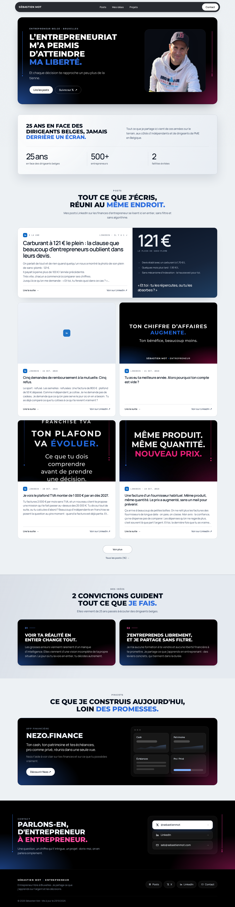 → 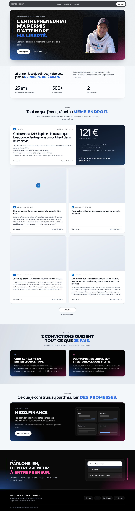 | 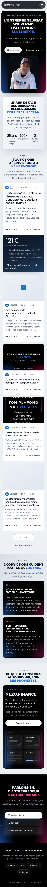 → 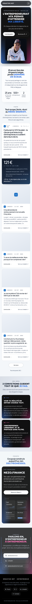 |
| Liste posts | 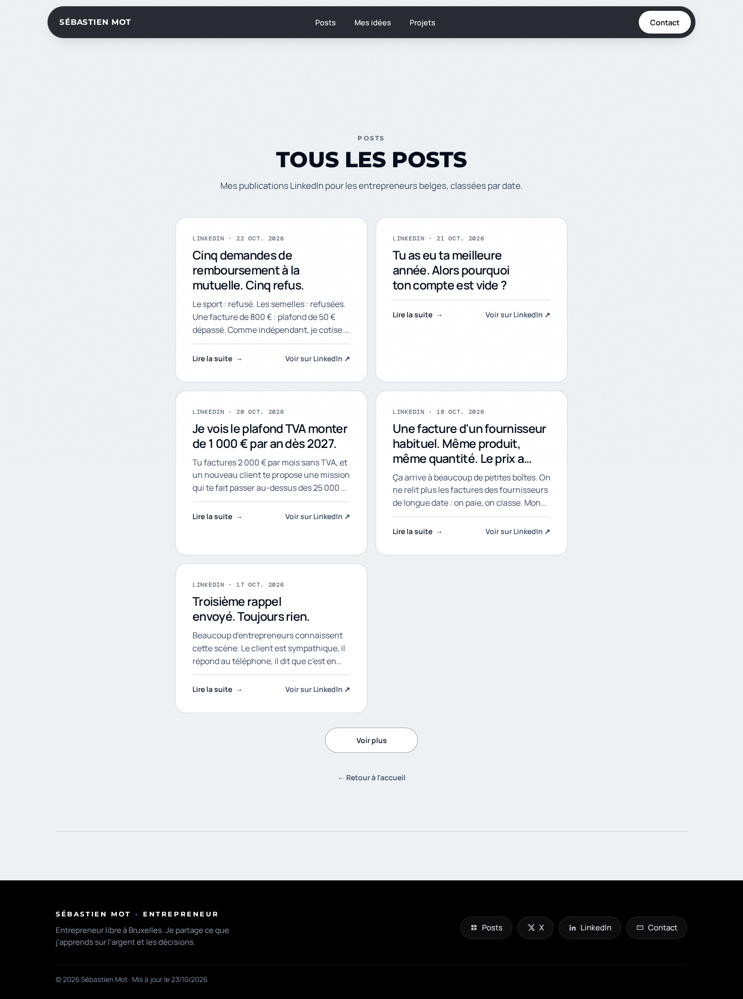 → 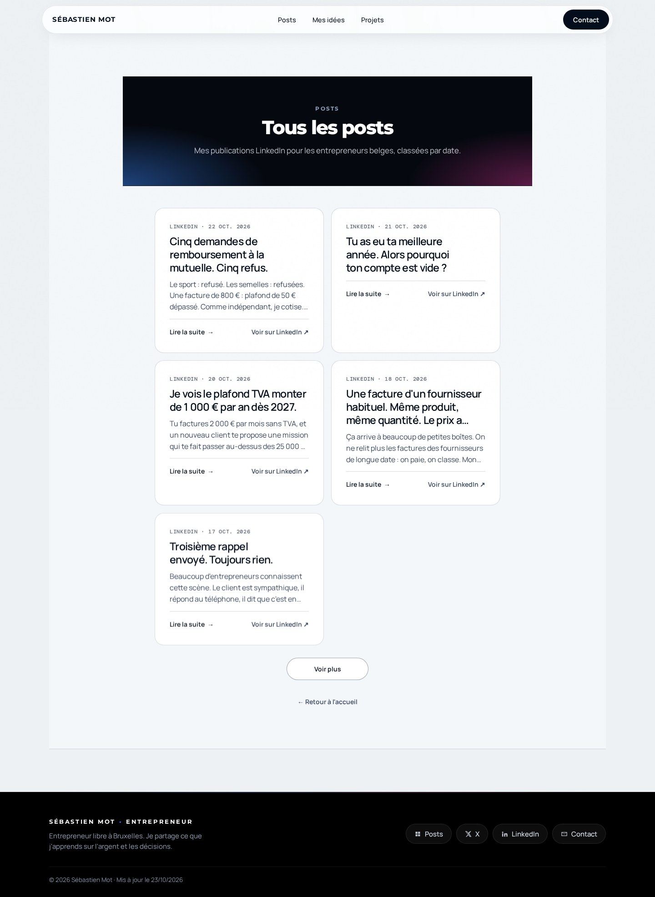 | 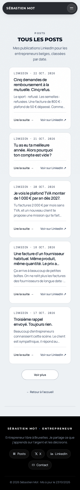 → 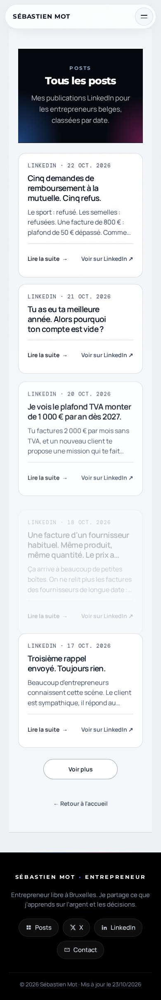 |
| Article | 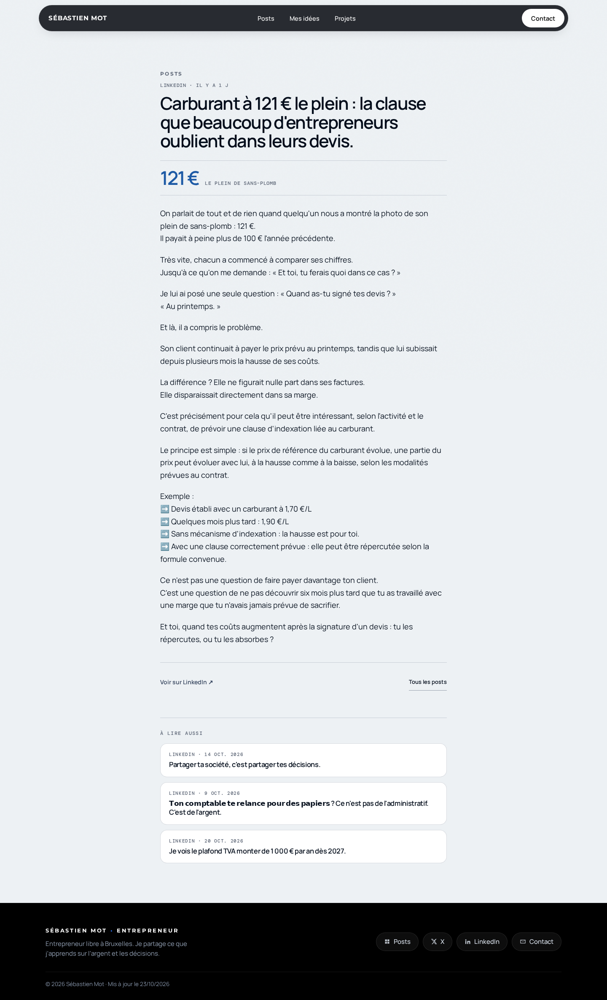 → 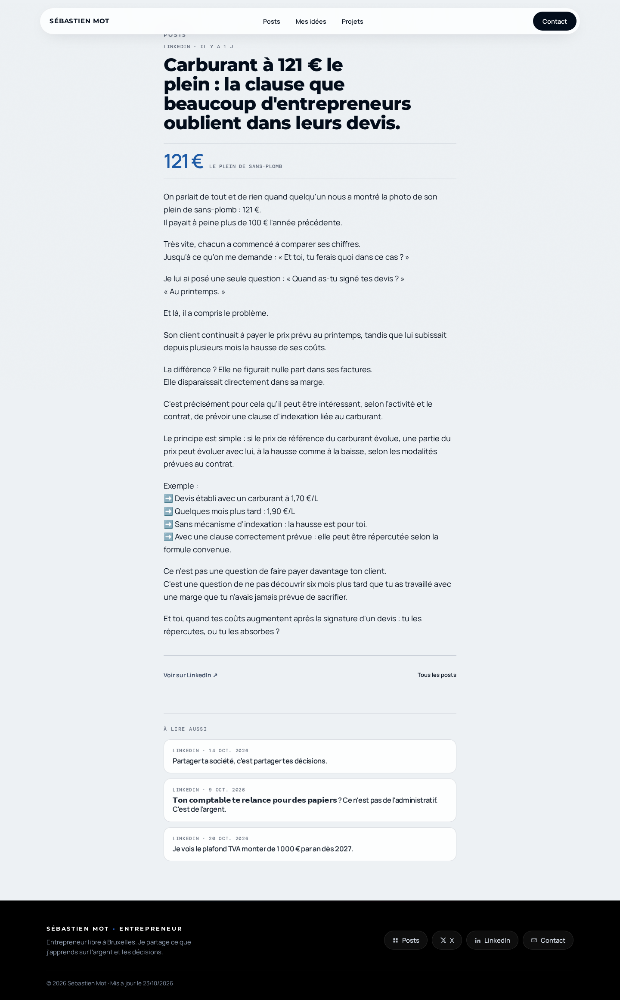 | 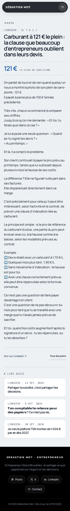 → 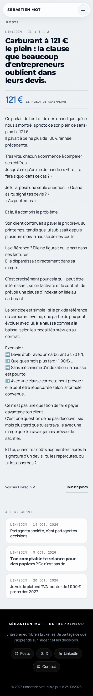 |
| 404 | 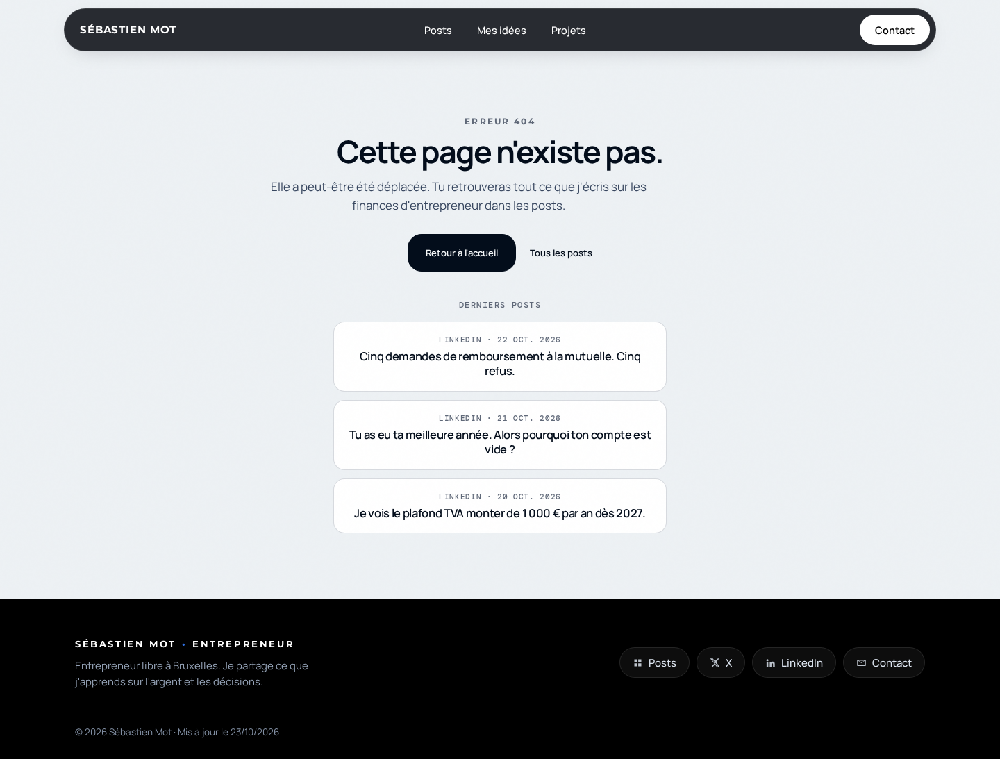 → 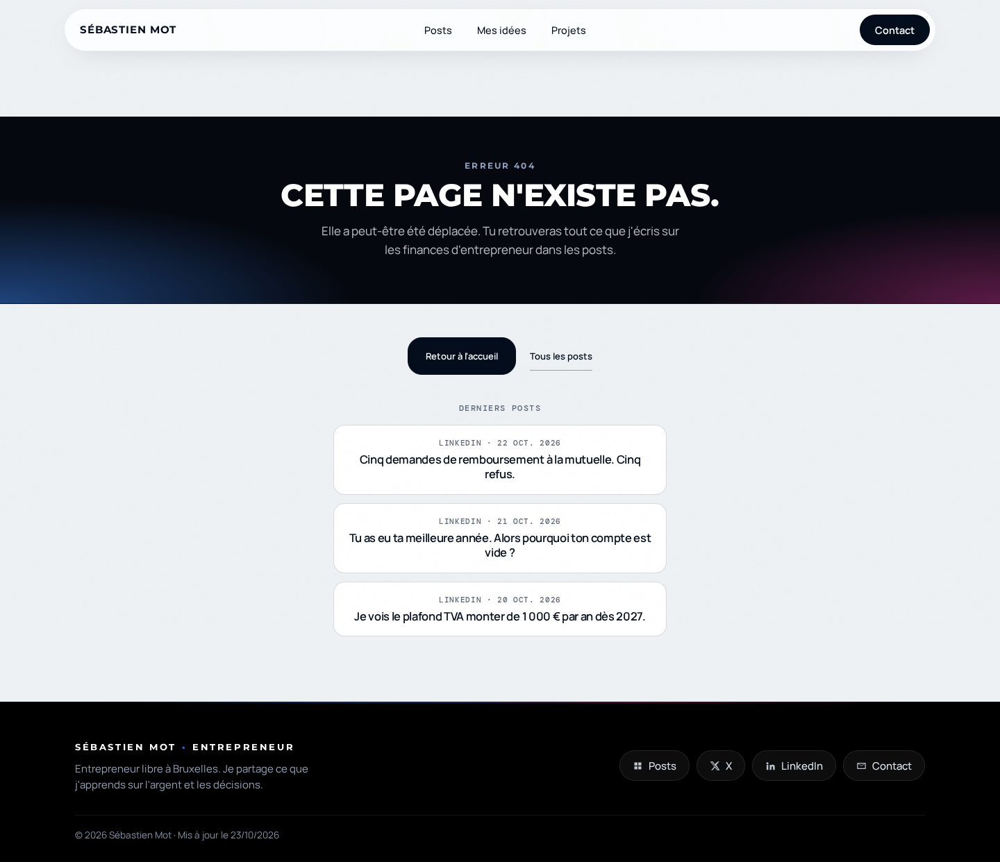 | 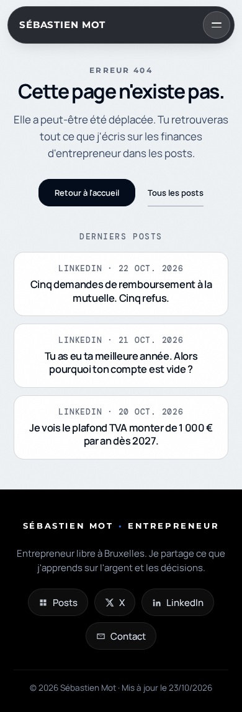 → 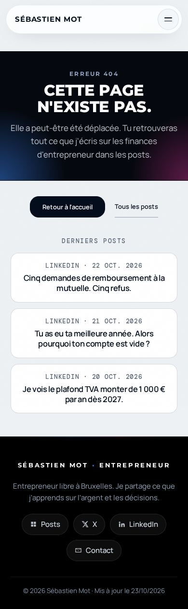 |

Régénération : `python3 build.py` puis serveur sur `dist/` port `8765`, puis `python3 scripts/capture_screenshots.py design-before|design-after`.

---

## Critique page par page

### Accueil (`/`)

**Desktop 1440 — avant**  
- Hero en carte noire : bonne direction affiche, mais **mesh statique**, points/lignes verticales **gadget**, portrait en « carte grise » peu premium.  
- Bloc « 25 ans » : panneau flottant correct, typo **100 % caps** = fatigue.  
- Grille posts : cartes homogènes (progrès), mais **placeholders gris** et featured encore très « bloc CMS ».  
- Convictions / Nezo / Contact : **même traitement affiche répété** → effet template, pas hiérarchie.

**Mobile 390 — avant**  
- Hero centré lisible ; CTA ok.  
- Stats en colonne : dense mais acceptable.  
- Grille 1 colonne : **longueur excessive** sans respiration entre cartes.

**Après signature**  
- Mesh + grain animés (respect `prefers-reduced-motion`).  
- Entrée typo hero en cascade ; hover portrait léger.  
- Sections claires en **Manrope sentence-case** ; accents Montserrat sur les `em.accent` seulement.  
- Cartes posts : **bordure gradient + lift** au survol, images toujours visibles (cover + overlay).  
- Nav **clair sur fond clair** / sombre sur hero (attribut `data-header-tone`).

### Liste posts (`/posts/`)

**Avant**  
- Page la plus « WordPress » : **titre centré sur fond gris**, cartes texte seules, **aucune image**, peu de raison de rester sur le site plutôt que LinkedIn.

**Après**  
- **Bandeau affiche** (`sig-page-hero`) aligné sur l’identité.  
- Cartes archive : hover et reveal au scroll.  
- *Limite connue* : vignettes absentes tant que le build n’enrichit pas le template archive (hors périmètre grille JS).

### Article post

**Avant / après**  
- Bonne lisibilité corps 18px ; titre pourrait gagner un bandeau léger (non bloquant).  
- « À lire aussi » : cartes blanches cohérentes ; reveals ajoutés.

### 404

**Avant**  
- Message utile mais **visuellement nu**.

**Après**  
- Même bandeau affiche que la liste posts ; actions et liste « Derniers posts » inchangées fonctionnellement.

---

## Design system 2026 (fidèle à l’identité)

### Tokens

| Token | Valeur | Usage |
|-------|--------|--------|
| `--sig-navy` | `#05080f` | Fond affiche |
| `--sig-electric` | `#3d8bff` | Halo, liens accent, hover |
| `--sig-magenta` | `#e838a0` | Contre-glow |
| `--sig-surface` | `#f4f7fa` | Fond éditorial (posts, stats) |
| `--sig-ease` | `cubic-bezier(0.22, 1, 0.36, 1)` | Entrées / hover |
| `--sig-duration` | `0.75s` | Reveal section |
| `--sig-stagger` | `0.07s` | Lignes hero |

Couleurs marque historiques conservées : `--brand-blue`, `--brand-pink` (site.css).

### Grille & mesure

- **Gouttière** : `var(--gutter)` = `clamp(28px, 7.5vw, 144px)` — inchangé.  
- **Contenu max** : ~1120px (footer, CTA) ; colonne lecture article ~680px.  
- **Grille posts accueil** : 2 colonnes ≥861px (logique existante), cartes **stretch** même hauteur de média 16:10.

### Échelle typographique

| Rôle | Famille | Taille (desktop) | Notes |
|------|---------|------------------|--------|
| Hero | Montserrat 800 | `clamp(2.5rem, 3.75vw, 3.7rem)` | Affiche, blanc sur noir |
| Section claire | Manrope 700 | `clamp(1.85rem, 3.4vw, 2.6rem)` | Phrase case ; accent en caps |
| Kicker | Montserrat 700 | `11.5px`, tracking `0.2em` | Toujours caps |
| Corps | Manrope | `16–18px` | Posts, lead |
| Méta | DM Mono | `11–12px` | Dates, filtres |

### Rayons & élévation

- Cartes : `var(--radius)` 18–20px.  
- Hero carte : `28px`.  
- Ombres : une seule couche `0 24px 48px -32px` + teinte bleue au hover (pas de double ombre empilée).

### Motion (principes)

1. **Durée courte** (< 1s), **une propriété dominante** (transform ou opacity).  
2. **`prefers-reduced-motion`** : pas d’animation mesh, reveals instantanés, pas de lift hover.  
3. **Pas de parallax lourd** — perf mobile first.  
4. **Reveal au scroll** : `IntersectionObserver` + classe `.is-in` (fichier `assets/js/motion.js`).  
5. **Hero** : mesh CSS uniquement (pas de canvas / Lottie).

### États interactifs

- **Post card** : translateY −5px, border gradient bleu→magenta, image scale 1.045, overlay bas.  
- **Boutons hero** : lift + glow blanc léger.  
- **Nav** : pill active sur fond clair/sombre selon `data-header-tone`.  
- **Footer liens** : pills glass + lift 1px.

### Références (ambiance, pas copie)

- Affiches **Monocle / FT** : typo forte, peu de chrome.  
- **Linear / Vercel** (2024–26) : mesh discret, glass nav, motion sobre.  
- **Visuels LinkedIn Sébastien Mot** : navy + glow bilatéral = référence primaire couleur.

---

## Fichiers de la couche signature

| Fichier | Rôle |
|---------|------|
| `assets/css/signature-2026.css` | Tokens, hero mesh, reveals, cartes, bandeaux, nav tone |
| `assets/js/motion.js` | Tone header, reveals, cartes dynamiques accueil |
| `templates/base.html` | Chargement CSS/JS global |
| `templates/home_body.html` | Calque `hero-ambient` |
| `templates/posts_index.html`, `404.html` | Bandeau `sig-page-hero` |

**Non modifié** (coordination PR #6) : `build.py` logique posts, `home.js` / `posts-archive.js` données, grille `post-grid`.

---

## Pistes suivantes (hors cette PR)

- Vignettes sur la **liste posts** serveur (template + `posts.json`).  
- **Dark mode** optionnel via `prefers-color-scheme` (tokens déjà esquissés dans `maquette.html`).  
- Consolidation CSS : fusionner les blocs `v7/v8/Identité` pour réduire les `!important`.
